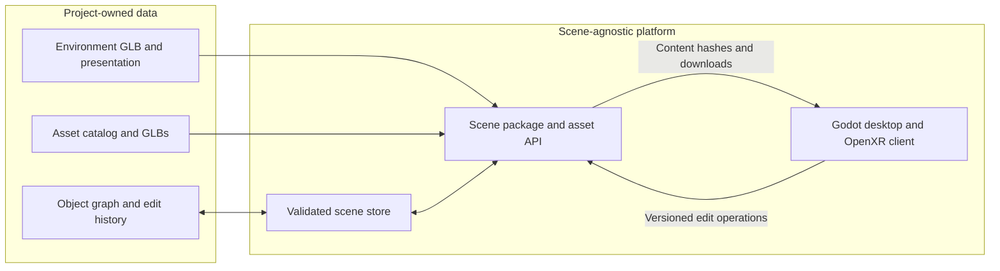

# Architecture

Worldsmith is a scene-creation harness: it coordinates asset requests, review, assembly, runtime editing, persistence, and export. It separates that platform behavior from scene content. A selected project's data defines its environment GLB, catalog assets, object graph, collision roles, material overrides, lighting, and player spawn. No scene or catalog is selected in application source.



The project data selects what appears in a world. The platform applies the same loading, editing, saving, and rendering behavior to every project.

## Runtime

The Godot client uses a `CharacterBody3D` for desktop and OpenXR locomotion. Local visual previews load a GLB selected by ignored preview configuration. Optional `overlays` load further aligned GLBs, so geometry layers can be authored and versioned separately. The client builds collision from mesh-name filters supplied in that configuration: `collision.walkable` creates teleportable layer 1 surfaces, and `collision.solid` creates layer 2 obstacles. `hidden_meshes` hides named meshes. Optional `materials` entries assign a shader and texture parameters to matching meshes; `sky`, `fog`, and `lights` configure presentation. Missing preview data means an empty workspace, not a built-in environment.

A preview configuration has this shape; names and file paths are supplied by the scene author:

```json
{
  "glb": "res://assets/local/<environment>.glb",
  "overlays": ["res://assets/local/<geometry-layer>.glb"],
  "spawn": [0, 1.8, 0],
  "collision": {"walkable": ["<walkable-mesh-name>"], "solid": ["<solid-mesh-name>"]},
  "hidden_meshes": [],
  "materials": [{"mesh": "<mesh-name>", "shader": "res://assets/local/<shader>.gdshader", "textures": {}}],
  "lights": [],
  "sky": {},
  "fog": {"enabled": true, "color": [0.7, 0.72, 0.73], "density": 0.005}
}
```

When connected, the client fetches `/api/scenes/<id>/package`. The package identifies a content-hashed environment GLB, optional repeated mesh groups, and presentation settings. The client caches and loads these at runtime. An unregistered scene opens empty. The client also fetches the selected scene's asset catalog and downloads missing GLBs into a scene-specific cache. Inventory pages are built from that catalog, so a new asset or scene needs no code edit. Placed objects have stable UUIDs and Y-up transforms in meters. `WorldsmithSceneEditor` records local edits; `WorldsmithSceneSync` queues them over a WebSocket and reconciles revisions on reconnect.

## Server and storage

The FastAPI server stores each scene under `data/projects/<scene_id>/`. A new install starts with no scenes. `POST /api/scenes` creates an empty scene. An optional `WORLDSMITH_SCENE_SEED` plus `WORLDSMITH_INITIAL_SCENE_ID` can initialize one from external data; those settings do not change application code. `catalog.json` lists assets offered for placement and optional display names and walkability. The server validates assets and operations before persisting them.

`scene.json` is the current snapshot; `history.json` is an append-style edit history with a cursor for undo and redo. Writes atomically replace history before the snapshot. If interrupted between those writes, the next read replays history and repairs the snapshot. WebSocket messages send deltas or a fresh snapshot. The scene server is intended for a trusted LAN and currently has no authentication.

A registered environment GLB is stored as project data for runtime loading and export. `scripts/register_environment.py` accepts any valid GLB, an explicit scene ID, and optional presentation settings. Those settings include spawn, collision roles, hidden meshes, sky, fog, and lights. The export worker composes the base environment and visible placed objects in Blender, then writes a source-hash manifest. Repeated mesh transforms can be carried in instance sidecars. The source Blender file is not modified by local preview or server export.

## Asset production and review

The reusable library is separate from any project catalog. A newly generated or revised file can be registered as a candidate without changing the current version. A reviewed version is promoted by its content hash; project data then chooses which version to use. For a new object, the client defaults to a reviewed-asset request: the server saves the prompt and viewed target without placing draft geometry. A promoted library mesh can fulfill that request and is copied into the project under a versioned name, added to its catalog, placed, and saved as one undoable edit. The user can explicitly choose quick draft shapes instead. A separate scene command mode asks the LLM for a bounded production brief and saves it under the selected project without changing the editable scene. That brief lists terrain, routes, visual direction, lighting, and reusable asset families. Automatic asset production, assembly from the brief, and headset quality review remain future capabilities.

```mermaid
flowchart LR
    Prompt[Scene prompt] --> Request[Saved asset request and target]
    Prompt --> Brief[Saved scene brief and asset list]
    Brief -. planned asset families .-> Source
    Request -. asset production .-> Source[Authored or generated source assets]
    Source --> Candidate[Versioned candidate in library]
    Candidate --> Cleanup[Blender cleanup, UVs, PBR bake, LOD and collision]
    Cleanup --> Gate[GLB structure and device-budget checks]
    Gate --> Review[Eye-level Godot and headset review]
    Review -->|Accepted hash| Library[Promoted reusable asset]
    Review -->|Needs work| Cleanup
    Library --> Fulfill[Versioned library asset fulfillment]
    Request --> Fulfill
    Fulfill --> Assembly[Project-specific placement]
    Brief -. planned layout .-> Assembly
    Assembly --> Project[Environment, catalog and placements]
    Project --> API[Scene package API]
```



Structural checks report estimated draw calls, triangle counts, and embedded texture bytes against caller-supplied budgets. They cannot establish visual quality; the render review decides whether a candidate meets the project's references.

## Boundaries

Collision names in a preview config are author supplied; arbitrary GLBs do not automatically become walkable. The client currently uses approximate triangle collision for configured surfaces and simple selection bounds for placed assets. A catalog entry can mark an asset as walkable. Physical headset movement follows OpenXR tracking, while stick and keyboard motion use the character collider. Blender-specific modifiers and shader graphs need export baking or a corresponding Godot shader. Quest performance, comfort, and visual parity require device testing.
